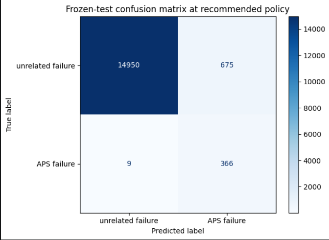

# APS Failure at Scania Trucks

We are predicting air-pressure-system failures (APS) in trucks for the company Scania part of TRATON SE Group worth ~€17B. Majority owned by Volkswagen. 

Using a trained random forest 97.6% of actual APS failures are predicted with 35% of all our marked predictions turning out to be actual failures.

Since the cost of a check is "10" per the dataset and the cost of a missed failure is "500" for x checked trucks that represents
(500x366) prevented loss - (675x10) unncessary check costs - (366x10) necessary check cost = 172 590 net prevented loss for a cost of 3090 plus minimal 
electricity to run the model.

Technical appendix

> Put in precision and recall here

Do-Nothing Cost (Baseline): 375 missed failures × 500 = 187,500 cost units
Our Policy Cost (Random Forest): (20 missed × 500) + (625 unnecessary × 10) = 16,250 cost units (with actual optimal threshold values)
Exact Gain (Cost Avoided): 187,500 − 11,250 = 176,250 cost units saved

## Slide 1 - Conclusion

Use Random Forest to rank trucks by estimated APS-failure risk.

Send the highest-risk cases to mechanic inspection.

Do not automatically declare a truck safe or unsafe.

Official test at the development-selected cost-aware threshold: **35.2% precision**, **97.6% recall**, **51.7% F1** and **1,041 inspections out of 16,000 trucks**.

## Slide 2 - Operational conclusion

The Scania cost matrix makes a missed APS failure 50 times more expensive than an unnecessary inspection.

- Unnecessary inspection: **10 challenge cost units**.
- Missed faulty truck: **500 challenge cost units**.
- Recommended official-test cost: **11,250 units**.
- Cost avoided versus inspecting nobody: **176,250 units**.

The result is conditional challenge-unit arithmetic, not measured causal savings. A mechanic remains responsible for the final decision.

## Slide 3 - Required operating-point and model table

| Model | Development ROC-AUC | Development average precision | Best development cost | Cost avoided vs all-negative baseline |
|---|---:|---:|---:|---:|
| Random Forest | 0.983 | 0.705 | 46,220 | 453,780 |
| Logistic Regression | 0.968 | 0.668 | 67,900 | 432,100 |
| Decision Tree | 0.932 | 0.567 | 82,280 | 417,720 |
| Majority baseline | 0.500 | 0.017 | 500,000 | 0 |

Random Forest was selected using development out-of-fold evidence. The official test was not used to select the model or threshold.

## Slide 4 - Data and target

UCI APS Failure at Scania Trucks.

60,000 labelled training examples. 170 anonymised operational predictors. 1,000 positive APS failures and 59,000 negative examples.

The separate official test file contains 16,000 labelled examples, including 375 positive APS failures.

Unit: one selected truck operating example.

The positive class is failure of the APS component in focus. The negative class is a failure unrelated to that APS component.

The label is a benchmark class, not an observed future time-stamped failure outcome.

The notebook also shows a reader-friendly preview: `class` is the target, the `aa_000`-style names are anonymised operational measurements or histogram bins, and `NaN` means that a measurement is missing. The public UCI release does not reveal the physical meaning of each individual feature.

## Slide 5 - Preparation

The first data-loading code cell displays `training_frame.head()` and the dataset shapes before modelling.

The full 60,000-row training file supplies development out-of-fold predictions. The separate 16,000-row official test file remains unavailable for model and threshold selection.

Missing `na` values are handled by median imputation and missingness indicators inside the pipeline.

Outlier clipping is also inside each pipeline, so bounds are learned only from the relevant training fold.

No rows are deleted because an unusual sensor value may be a genuine operational signal.

## Slide 6 - Models and validation

Candidates: majority baseline, Logistic Regression, Decision Tree and Random Forest.

The positive class is rare, so class weighting is used for the non-baseline models.

Random Forest was selected on development data using the asymmetric Scania cost criterion. ROC-AUC, average precision, recall, precision, F1, calibration and cost were checked.

The official test is scored once after the model and operating policy are frozen.

## Slide 7 - Outliers and sensitivity

Outliers were detected feature by feature:

- Approximately symmetric features: z-score limits of **mean +/- 3 standard deviations**.
- Skewed/non-normal features: Tukey's **1.5 x IQR** rule.
- **118** features use IQR, **6** use z-score and **46** have insufficient variation for clipping.

Extreme values are capped inside the training pipeline; observations are not removed.

Sensitivity changes the challenge-cost assumptions, not the model predictions. The recommendation remains cost-saving under lower missed-failure cost, severe missed-failure cost and expensive inspection scenarios.

## Slide 8 - Policy and governance

Rank trucks by the Random Forest APS-failure score.

Use the development-selected score threshold of approximately **0.146** for the recommended policy. At the official test this gives:

- TP=366, FP=675, FN=9, TN=14,950.
- Precision=35.2%; recall=97.6%.

Keep human decision authority. Record inspection outcomes. Monitor false negatives, inspection workload, missingness, calibration, drift and subgroup error rates.

The missingness-burden audit is diagnostic only; no protected-group attributes are available.

## Slide 9 - Recommendation

Use Random Forest as an inspection-prioritisation aid alongside the existing maintenance workflow.

The model captures most labelled APS-failure cases at the recommended cost-aware point, but the benchmark label does not prove that inspections prevent future breakdowns.

Before deployment, obtain timestamped prospective outcomes, actual inspection results and operational cost data. Validate whether the policy reduces missed APS failures without creating unacceptable mechanic workload.

## Appendix 1 - Metrics and curves

ROC-AUC evaluates how well the model ranks APS-failure examples above unrelated-failure examples over many possible cutoffs.

Average precision summarises the precision-recall behaviour and should be compared with the positive base rate of approximately 1.67% in the training data.

The notebook generates `figures/roc-pr-curves.png`, the ROC curve and precision-recall curve.

## Appendix 2 - Required operating-point table

The executed notebook contains the complete table with threshold rule, inspection count/rate, TP, FP, FN, TN, precision, recall, F1, unnecessary-inspection cost, missed-failure cost, total cost and cost avoided.

The diagnostic points include threshold 0.50, high recall, mid-range, high precision, cost-aware and illustrative top-10% capacity policies. The UCI case does not specify a real inspection capacity, so the capacity policy is explicitly illustrative.

## Appendix 3 - Sensitivity analysis

| Scenario | Unnecessary inspection cost | Missed failure cost | Total cost | Cost avoided vs all-negative |
|---|---:|---:|---:|---:|
| Official base | 10 | 500 | 11,250 | 176,250 |
| Lower missed-failure cost | 10 | 350 | 9,900 | 121,350 |
| Severe missed-failure cost | 10 | 750 | 13,500 | 267,750 |
| Expensive inspection | 50 | 500 | 38,250 | 149,250 |

These are challenge-unit scenarios. They do not establish causal savings or real-world profitability.

## Appendix 4 - Governance and reproducibility

- Seed: **77**.
- Development: 60,000 labelled training rows with out-of-fold model and policy selection.
- Confirmation: 16,000 labelled official test rows scored once after freezing.
- Missing values: median imputation and missingness indicators inside pipelines.
- Outliers: feature-wise IQR or z-score clipping inside each training fold.
- Protected-group attributes are not supplied; the subgroup audit compares missingness burden only.
- Notebook: `notebooks/scania_aps_failure.ipynb`.
- Executed notebook: `notebooks/scania_aps_failure.executed.ipynb`.

## Appendix 5 - 

